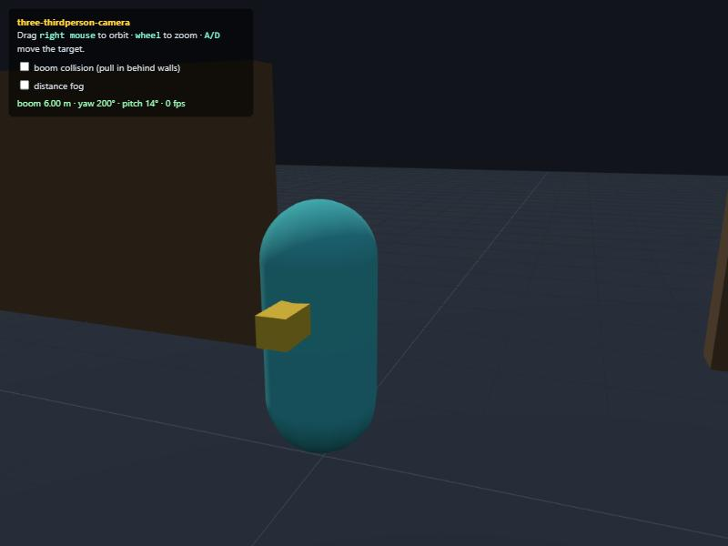

# three-thirdperson-camera

A drop-in **third-person orbit/follow camera** for [three.js](https://threejs.org) —
one small class, no dependencies beyond three itself, no renderer or loop of its own.
It orbits a target with mouse look and scroll-zoom, eases its position behind the
target with a damped chase, and (optionally) pulls its boom in when a wall comes
between the lens and the character so the view never clips through geometry.

Distilled from the third-person camera in a browser game engine and rewritten to be
genre-neutral: no engine, no globals, no DOM assumptions beyond the element you pass it.



## Features

- **Orbit** — mouse-drag (or pointer-lock) yaw/pitch around a target, with pitch
  clamps so it can't flip under the floor or over the top.
- **Scroll-wheel zoom** — dolly the boom in/out between a min and max.
- **Damped chase** — the camera eases toward its ideal spot, with the vertical axis
  heavier (it floats over terrain instead of bouncing with footsteps), and snaps on a
  teleport/scene change.
- **Boom collision** *(opt-in)* — raycast the pivot→camera line against colliders you
  supply and pull the boom in to the first hit, so the camera never ends up inside a
  wall.
- **Shoulder framing** — slide the pivot off-centre for an over-the-shoulder look.
- **Tight clip planes + distance fog** — the two view tweaks a third-person game
  usually needs: a tight far plane for depth precision on dense/coplanar scenery, and
  fog that dissolves the far plane into the sky.
- **Zero dependencies**, ~400 lines, framework-agnostic, works with any three.js r1xx.

For **occluder fade** — dithering out geometry between the lens and the character as an
alternative to the hard boom pull-in — use the companion module
[`occluder-dither-fade`](https://github.com/iniGlowee/occluder-dither-fade). This
camera exposes `rig.distance` each frame so that effect can tune its fade band to the
current boom length.

## Install

Copy `three-thirdperson-camera.js` into your project. It's an ES module; pass it your
`three` import (it never imports three itself, so there's only ever one copy of three).

## Usage

```js
import * as THREE from 'three';
import { ThirdPersonCamera } from './three-thirdperson-camera.js';

const camera = new THREE.PerspectiveCamera(50, innerWidth / innerHeight, 0.1, 120);

const rig = new ThirdPersonCamera({
  THREE,                               // pass the three module
  camera,                              // the camera to drive
  domElement: renderer.domElement,     // where to listen for look/zoom input
  target: player,                      // a THREE.Object3D (or anything with .position)
  colliders: () => scene.children,     // optional — enables boom collision
  distance: 5, lookHeight: 1.5, shoulder: 0.3,
  collide: true, nearPlane: 0.1, farPlane: 120,
});

function frame(dt) {
  // ... move your player ...
  rig.update(dt);                      // once per frame, before rendering
  renderer.render(scene, camera);
}
```

## Options

All optional except `THREE` and `camera`.

| Option | Default | What |
|---|---|---|
| `target` | – | Object3D / `{position}` to orbit (settable later via `setTarget`) |
| `colliders` | – | `() => Object3D[]` to raycast for boom collision |
| **Framing** | | |
| `distance` | `4` | starting boom length (m) |
| `lookHeight` | `1.6` | pivot height above the target origin |
| `shoulder` | `0` | off-centre framing along the camera's right (m) |
| `minPitch` / `maxPitch` | `-60` / `75` | pitch clamp (deg) |
| `startPitch` | `12` | initial pitch (deg, down-looking positive) |
| **Look** | | |
| `sensitivity` | `0.15` | deg of orbit per pixel |
| `invertY` | `false` | |
| `pointerLock` | `false` | lock the pointer and always look, vs. drag-to-look |
| `dragButton` | `2` | mouse button that drags the look when not pointer-locked |
| `keyLook` / `keyLookSpeed` | `false` / `120` | arrow keys also orbit (deg/s) |
| `lookSmooth` | `0` | seconds of "mass" on the look (0 = raw) |
| **Zoom** | | |
| `wheelZoom` | `true` | |
| `zoomMin` / `zoomMax` / `zoomStep` | `1.5` / `24` / `1.2` | |
| **Chase** | | |
| `chaseLag` | `0.08` | seconds of position damping (0 = glued) |
| `snapDistance` | `4` | jump further than this → snap (no smear on teleport) |
| **Collision** | | |
| `collide` | `false` | pull the boom in when blocked (needs `colliders`) |
| `collideMargin` / `collideMin` | `0.3` / `0.6` | keep off the wall / never closer than |
| **Projection + fog** | | |
| `nearPlane` / `farPlane` / `fov` | `0` / `0` / `0` | `>0` overrides the camera's value |
| `fog` | `false` | enable distance fog (call `rig.applyFog(scene)`) |
| `fogColor` / `fogStart` / `fogSky` | `0x8899aa` / `0.5` / `true` | colour / start fraction / paint background |

## API

- `new ThirdPersonCamera(opts)` — see above.
- `rig.update(dt)` — advance one frame (seconds). Call before rendering.
- `rig.setTarget(obj)` — change what it orbits.
- `rig.faceTargetHeading()` — snap the orbit behind the target's current facing.
- `rig.applyFog(scene)` / `rig.clearFog(scene)` — add/remove the distance fog.
- `rig.set({ ...options })` — change options at runtime.
- `rig.dispose()` — remove all input listeners.
- Read `rig.yaw`, `rig.pitch`, `rig.distance` any time (e.g. to drive an occluder fade).

**Mark a collider the camera should ignore** (a glass pane, a grass billboard) by
setting `mesh.userData.cameraTransparent = true`; the boom passes through it. The
target object (and its children) are always ignored, since the ray starts inside it.

## Verification

The demo (`demo.html`, three.js from CDN) was verified end-to-end in a real browser:

- **Orbit** — a 100 px right-drag turns yaw exactly −15° (100 × 0.15°/px).
- **Zoom** — two wheel notches extend the boom by 2.4 m (2 × 1.2 m/notch).
- **Collision** — with a wall 1.3 m behind the character and the boom set to 10 m, the
  camera pulls in to **1.05 m** (hit − 0.3 margin); with collision off it stays at the
  full **9.97 m**.
- **Fog** — `farPlane 120`, `fogStart 0.45` → fog near 54 / far 120.

Open `demo.html` over any static server (`python -m http.server`) to drive it yourself:
right-drag to orbit, wheel to zoom, `A`/`D` to walk the target into a wall, and toggle
collision and fog.

## Non-goals

- Not a full character controller — it follows a target you move; it doesn't move it.
- Not an `OrbitControls` replacement for CAD/inspection (no panning, no auto-rotate).
- Occluder fade lives in its own module (linked above), not here.

## License

[MIT](LICENSE) — "three-thirdperson-camera contributors". Distilled from the AE1
("Angel's Egg") browser engine's camera; contains no game assets or engine code, only
this standalone reimplementation.
